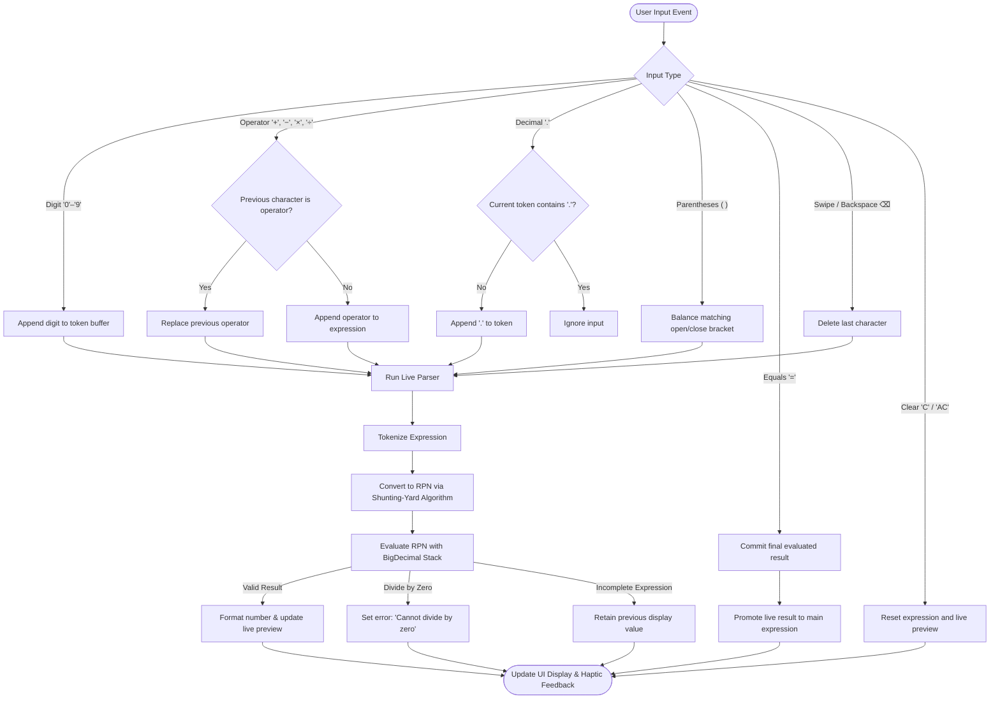

# Kalculator - Android Kotlin Arithmetic Calculator


-2E7D32?style=for-the-badge&logo=android&logoColor=white)


A modern, sleek, and intuitive arithmetic calculator application built for Android using **Kotlin** and **Material 3 Design**. Engineered for mathematical precision via Dijkstra's Shunting-yard algorithm, high-precision `BigDecimal` arithmetic, real-time live preview, tactile haptics, and responsive touch gestures.

---

<table align="center">
  <tr>
    <td align="center">
      
      <br/><sub><b>App icon</b></sub>
    </td>
    <td align="center">
      
      <br/><sub><b>App interface</b></sub>
    </td>
  </tr>
</table>

---

## Table of Contents

- [Features](#features)
- [Technology Stack](#technology-stack)
- [Project Structure](#project-structure)
- [Calculation Schema](#calculation-schema)
- [System Workflow](#system-workflow)
- [Build and Run](#build-and-run)
- [Running Unit Tests](#running-unit-tests)
- [Direct APK Download](#direct-apk-download)
- [Author](#author)

---

## Features

### Mathematical & Calculation Engine

- **PEMDAS / BODMAS Operator Precedence:** Evaluates expressions strictly according to mathematical rules using Dijkstra's Shunting-yard algorithm and Reverse Polish Notation (RPN). Multiplication (`×`) and Division (`÷`) take precedence over Addition (`+`) and Subtraction (`−`).
- **Parentheses Grouping:** Full support for sub-expressions and arbitrary nesting with balanced parentheses `( )`.
- **Arbitrary-Precision Arithmetic:** Uses Java's `BigDecimal` with 16 digits of precision (`MathContext(16, RoundingMode.HALF_UP)`), completely eliminating standard IEEE 754 floating-point errors (e.g., `0.1 + 0.2 = 0.3`).
- **Dynamic Percentage Handling (`%`):** Evaluates standalone percentages (`8%` → `0.08`), percentage multipliers (`50%200` → `100`, `25%80` → `20`), and additive percentage calculations (`200 + 10%` → `200.1`).
- **Division-by-Zero Safety:** Safely intercepts division by zero before evaluation and reports a clear `"Cannot divide by zero"` error without crashing.
- **Smart Operator Replacement:** Automatically substitutes the last operator when typing consecutive operations (e.g. entering `+` then `×` cleanly switches to `×`).

### User Interface & Gesture Controls

- **Real-Time Live Preview:** Automatically computes and displays the live evaluation in the secondary display line as you type, before pressing `=`.
- **Swipe-to-Backspace Gesture:** Swipe horizontally across the display or expression field to quickly delete characters one by one.
- **Tactile Haptic Feedback:** Triggers subtle system haptics (`HapticFeedbackConstants.KEYBOARD_TAP`) on every button tap and gesture for a responsive physical keypad feel.
- **One-Tap Clipboard Copy:** Long-press either the expression or the computed display text to instantly copy sanitized numbers to the system clipboard with an on-screen toast confirmation.
- **Dual Clear Controls:** Tap `⌫` for single-character backspace; tap `C` or `AC` to clear; long-press `⌫` or `AC` to perform an instant full reset.
- **Auto-Scrolling Expression Fields:** Smoothly auto-scrolls long expressions and multi-digit results horizontally to keep the active cursor and latest digits in view.

### System & State Integration

- **Edge-to-Edge Display:** Uses `WindowInsetsCompat` to adapt to modern Android status and navigation bars.
- **State Persistence Across Rotation:** Implements `onSaveInstanceState` and `onRestoreInstanceState` with serializable engine snapshots to preserve your active calculation across device screen rotations.
- **AMOLED Dark Palette:** High-contrast dark theme (`#0B0B0E` background, `#1A1B22` keypad, `#2E303A` operators) engineered for optimal battery life and readability.

---

## Technology Stack

> **Platform Requirement:** Designed for modern Android devices running Android 9.0 (API Level 28) and higher, targeting API 37.

| Component | Version / Specification | Notes |
| :--- | :--- | :--- |
| **Language** | Kotlin 1.9+ | Modern concise Kotlin with null safety and extension functions |
| **Platform** | Android 9.0 (API 28) to API 37 | Targets modern Android releases |
| **IDE** | Android Studio Ladybug / Meerkat | Tested with modern Android Studio builds |
| **Build System** | Gradle 9.6.0 & AGP 9.5.1 | Configured via Kotlin DSL (`build.gradle.kts`) |
| **Dependency Management** | Gradle Version Catalog | Centralized versions in `gradle/libs.versions.toml` |
| **UI Framework** | Android Material 3 & AndroidX | Material Components, AppCompat, ConstraintLayout |
| **Test Framework** | JUnit 4.13.2 | Automated unit testing (`CalculatorEngineTest`) |

---

## Project Structure

The project separates the Android Studio application module (`Calculator/`) from root assets and distribution files:

```text
Kalculator/
├── Calculator/                               # Android Studio project root
│   ├── app/                                  # Main application module
│   │   ├── src/
│   │   │   ├── main/
│   │   │   │   ├── java/com/example/calculator/
│   │   │   │   │   ├── MainActivity.kt       # UI controller, button bindings, gestures, haptics
│   │   │   │   │   └── CalculatorEngine.kt   # Pure domain math parser (Shunting-yard & RPN)
│   │   │   │   ├── res/                      # Drawables, layouts, colors, strings, themes
│   │   │   │   └── AndroidManifest.xml       # Manifest declaration and launcher intent
│   │   │   └── test/java/com/example/calculator/
│   │   │       ├── CalculatorEngineTest.kt   # Unit tests verifying math accuracy and edge cases
│   │   │       └── ExampleUnitTest.kt        # Basic test assertion
│   │   ├── build.gradle.kts                  # App-level build script and SDK configurations
│   │   └── .gitignore
│   ├── gradle/
│   │   ├── libs.versions.toml                # Gradle Version Catalog for dependencies
│   │   └── wrapper/gradle-wrapper.properties # Gradle wrapper configuration (9.6.0)
│   ├── build.gradle.kts                      # Top-level project build script
│   ├── settings.gradle.kts                   # Module definitions and repository settings
│   ├── gradle.properties                     # JVM memory arguments and cache configurations
│   ├── gradlew / gradlew.bat                 # Gradle wrapper executable scripts
│   └── .gitignore
├── pngfiles/                                 # Media assets for documentation
│   ├── app icon.png                          # High-resolution launcher icon
│   └── app interface.png                     # Application interface screenshot
├── LICENSE                                   # MIT License
├── .gitignore                                # Root version control ignore rules
└── README.md                                 # Project documentation
```

---

## Calculation Schema

The core calculation logic is isolated in [`CalculatorEngine.kt`](Calculator/app/src/main/java/com/example/calculator/CalculatorEngine.kt). State transitions and evaluations rely on structured types:

| Model / Type | Fields / Subtypes | Purpose |
| :--- | :--- | :--- |
| `CalculatorState` | `displayText: String`, `expressionText: String`, `clearButtonText: String`, `hasError: Boolean` | Immutable state payload published to the UI controller |
| `CalculationResult` | `Success(value: BigDecimal)`, `Error(message: String)` | Sealed outcome of expression parsing and mathematical evaluation |
| `BundleData` | `expression: String`, `liveResult: String`, `hasError: Boolean`, `errorMessage: String?`, `isEvaluated: Boolean` | Serializable snapshot preserved across Activity recreations |

### Supported Operator Hierarchy

| Operator | Symbol | Precedence | Associativity | Function |
| :---: | :---: | :---: | :---: | :--- |
| `( )` | Parentheses | 4 | N/A | Sub-expression grouping |
| `%` | Percent | 3 | Left | Percentage transformation |
| `×`, `÷` | Multiply / Divide | 2 | Left | Core multiplication and division |
| `+`, `−` | Add / Subtract | 1 | Left | Core addition and subtraction |

---

## System Workflow



---

## Build and Run

### Option 1: Android Studio (Recommended)

1. Clone the repository:
   ```bash
   git clone https://github.com/INTE5HAR/Kalculator.git
   ```
2. Open **Android Studio**.
3. Select **Open** and choose the `Calculator` folder inside the cloned directory:
   ```text
   Kalculator/Calculator
   ```
4. Allow Android Studio to complete Gradle sync and download dependencies.
5. Select `app` from the run configurations dropdown.
6. Select your target device or emulator (e.g. Pixel 8 running API 34+) and press the green **Run (▶)** button (`Shift + F10`).

### Option 2: Command Line (Gradle Wrapper)

1. Open a terminal in the `Calculator/` folder:
   ```bash
   cd Kalculator/Calculator
   ```
2. Build the debug APK:
   ```bash
   # On Windows (PowerShell / Command Prompt)
   .\gradlew assembleDebug

   # On Linux / macOS
   ./gradlew assembleDebug
   ```
3. The compiled APK will be located at:
   ```text
   Calculator/app/build/outputs/apk/debug/app-debug.apk
   ```

---

## Running Unit Tests

The test suite validates math rules, operator precedence, division by zero, percentage logic, and edge cases.

### Run in Android Studio
1. In the Android Studio Project panel, navigate to:
   ```text
   Calculator/app/src/test/java/com/example/calculator/CalculatorEngineTest.kt
   ```
2. Right-click `CalculatorEngineTest.kt` and select **Run 'CalculatorEngineTest'** (`Ctrl + Shift + F10`).
3. All 8 tests will execute with green checkmarks.

### Run via Command Line
From the `Calculator/` directory, run:
```bash
.\gradlew testDebugUnitTest
```
A detailed test report will be generated at:
```text
Calculator/app/build/reports/tests/testDebugUnitTest/index.html
```

---

## Direct APK Download

For quick installation without building from source, a pre-compiled debug APK is available on the [Releases page](https://github.com/INTE5HAR/Kalculator/releases):

- 📦 **[Download app-debug.apk (v0.1.0-beta.1)](https://github.com/INTE5HAR/Kalculator/releases/download/v0.1.0-beta.1/app-debug.apk)** *(~13.1 MB)*

> **Installation Note:** To install on an Android device:
> 1. Open the download link above on your phone.
> 2. Open the file and allow **"Install from unknown sources"** if prompted by Android.
> 3. Follow the on-screen prompts to complete installation.

---

## Author

**Inteshar Alam**
- GitHub: [@INTE5HAR](https://github.com/INTE5HAR)
- Project: Developed as part of Mobile Programming coursework
- Date: November 2026
